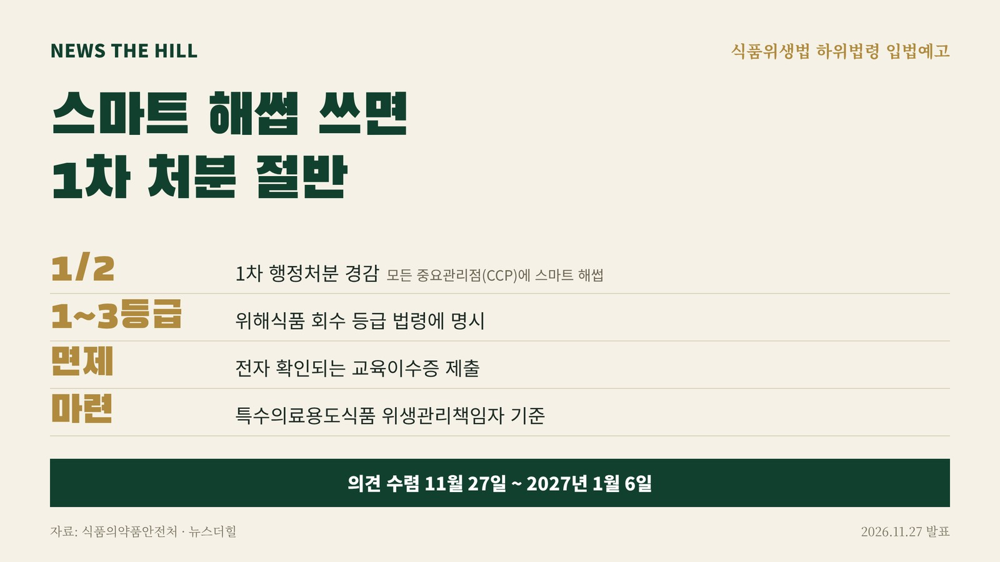

입력 2026-11-27

*그래픽=뉴스더힐(자료: 식품의약품안전처)*

식품제조·가공업소가 모든 중요관리점(CCP)에 스마트 해썹을 구축해 운영하면 관련 위반행위의 1차 행정처분이 2분의 1로 줄어든다. 지금은 지침으로 운영하는 위해식품 회수 등급과 절차도 법령에 명확히 담긴다.

식품의약품안전처는 이런 내용을 담은 「식품위생법 시행령」과 「식품위생법 시행규칙」 일부개정령안을 11월 27일 입법예고한다고 27일 보도참고자료에서 밝혔다. 개정안은 2027년 1월 6일까지 의견을 받은 뒤 규제 심사와 법제처 심사 등을 거쳐 최종 개정된다.

## 개정안 주요 내용

- 특수의료용도식품 위생관리책임자 자격과 선임기준 등 마련
- 모든 중요관리점(CCP)에 스마트 해썹 적용 시 1차 행정처분 2분의 1 경감
- 전자적으로 확인할 수 있는 교육이수증은 제출 면제
- 위해식품 회수 등급과 세부 절차를 법령에 명확히 규정

## 특수의료용도식품 위생관리책임자

특수의료용도식품의 특수성을 고려한 별도 관리체계를 마련하도록 「식품위생법」이 개정(2026년 5월 26일 공포, 2027년 5월 27일 시행)된 데 따라 법률이 위임한 세부 사항을 정한다. 위생관리책임자의 자격과 선임·해임 기준, 직무와 기록·보관 의무, 신규·보수 교육과 훈련 세부 내용, 품목제조(변경)신고 방법, 관련 위반행위에 대한 행정처분 기준 등이다.

## 스마트 해썹·교육이수증

스마트 해썹은 실시간 자동 기록·관리 시스템이다. 식약처는 처분 경감으로 제조업체의 자발적인 스마트 HACCP 도입을 유도하고 식품안전 관리의 디지털화를 넓힐 계획이라고 밝혔다.

신규 영업자가 영업허가·신고·등록을 신청하거나 영업자 지위승계를 신고할 때 교육이수 현황을 전자적으로 확인할 수 있으면 이수증을 내지 않아도 된다.

## 위해식품 회수 1~3등급

회수 등급은 위해 정도에 따라 1~3등급으로 나누고, 위해식품 특성에 따른 세부 분류 기준을 마련한다. 회수계획·결과 보고와 보완명령 등 세부 절차도 법령에 담는다.

- 위해도 기반: 방사능 기준 위반은 1등급, 납·카드뮴 등 중금속 기준 위반은 2등급, 대장균·세균수 기준 위반은 3등급
- 국제 기준 적용: 국제암연구소(IARC) 발암물질 분류 기준을 반영해 Group1(벤조피렌, 다이옥신 등)은 1등급, Group2(3-MCPD)는 2등급, Group3(셀레늄, 톨루엔 등)은 3등급
- 분류 체계 세분화: 기존 '식중독균' 분류를 장출혈성 대장균, 살모넬라 등 개별 균종별 위해도에 따라 나누고, 곰팡이독소도 아플라톡신, 파튤린, 제랄레논 등으로 구분

자세한 내용은 국민참여입법센터(opinion.lawmaking.go.kr)와 식약처 누리집의 입법/행정예고에서 확인할 수 있다.

※ 이 기사는 식품의약품안전처 보도참고자료(정책브리핑 전재, 공공누리 제1유형·텍스트에 한함)를 바탕으로 작성했습니다.
