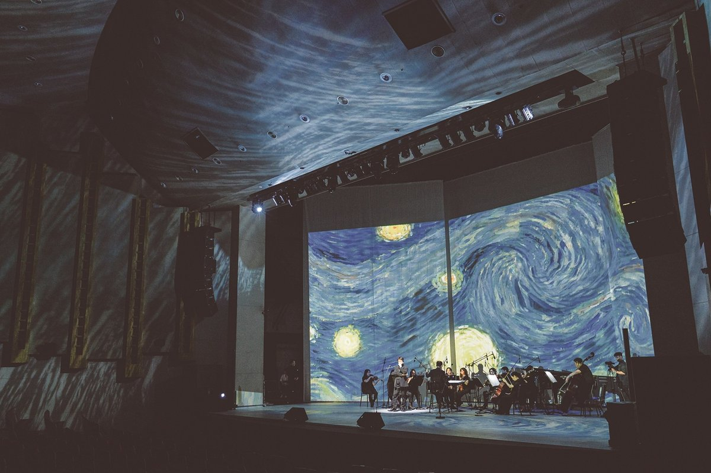
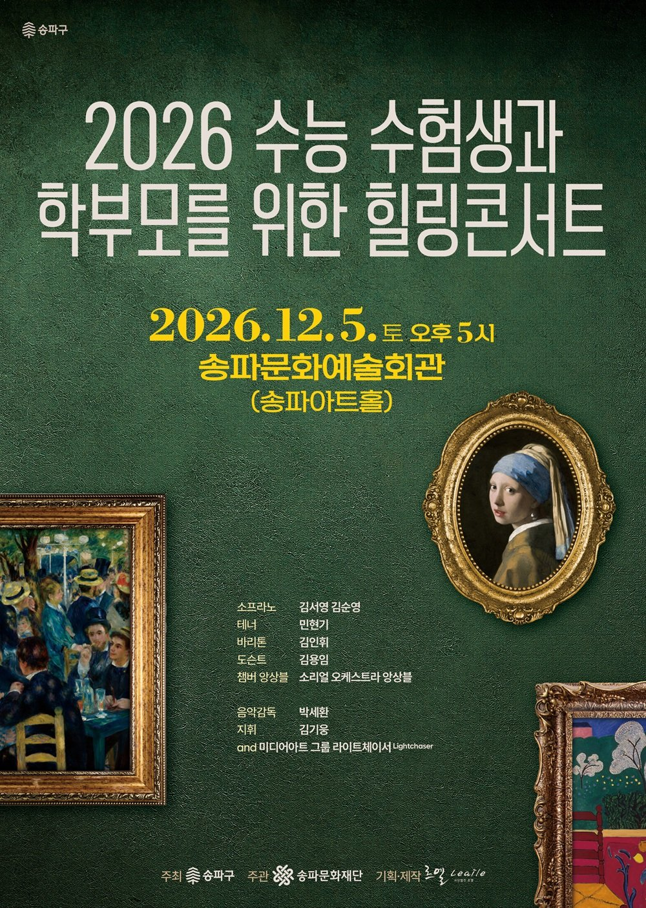
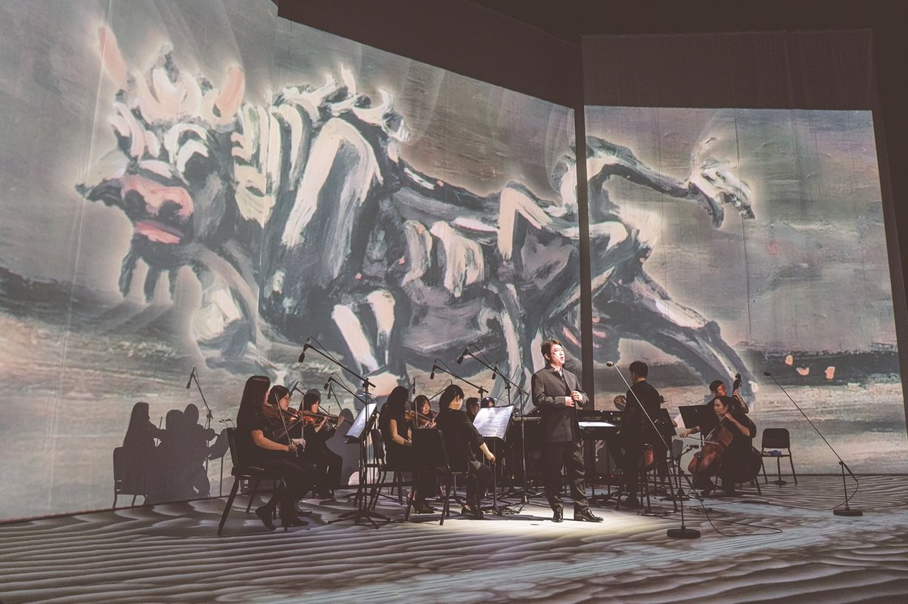
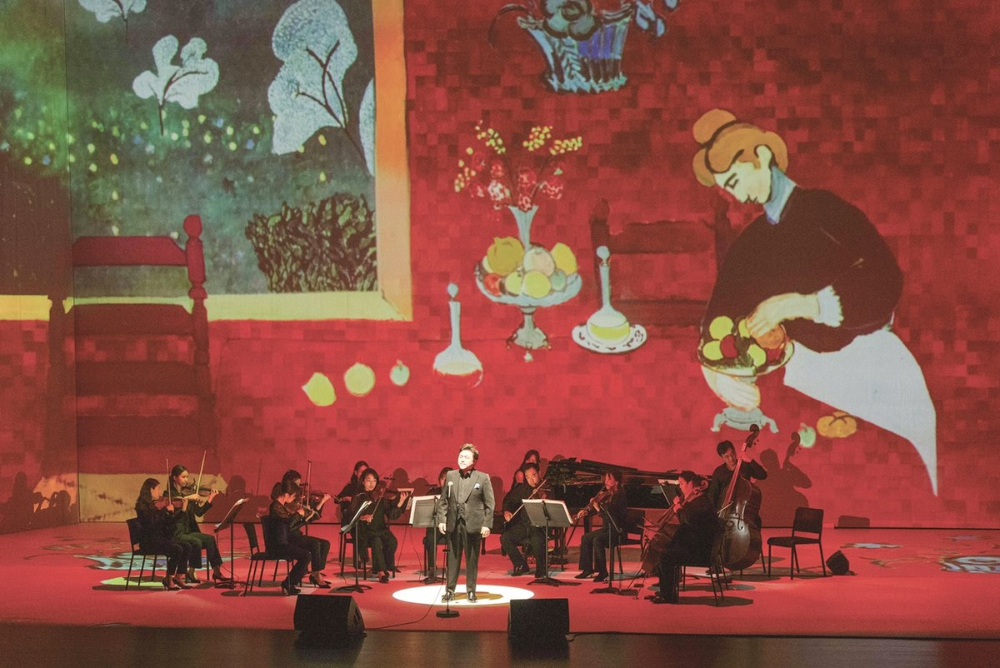

입력 2026-11-27

*미디어파사드로 구현한 명화 영상을 배경으로 앙상블이 연주하는 모습. 사진=송파구 제공*

수능을 향해 달려온 수험생과 곁을 지킨 학부모를 위해 명화와 음악을 한 무대에서 만나는 무료 공연이 열린다.

서울 송파구(구청장 서강석)는 27일 보도자료에서 12월 5일(토) 오후 5시 송파문화예술회관 송파아트홀에서 '2026 수능 수험생과 학부모를 위한 힐링콘서트'를 전석 무료로 연다고 밝혔다. 송파구가 주최하고 송파문화재단이 주관한다.

## 명화 영상에 도슨트 해설·성악·앙상블

무대는 미디어아트 그룹 라이트체이서가 미디어파사드 영상으로 구현한 페르메이르·르누아르·고흐·클림트의 명화로 채워진다. 작품 해설은 도슨트 김용임이 맡는다.

소프라노 김서영·김순영, 테너 민현기, 바리톤 김인휘와 소리얼 오케스트라 앙상블이 클래식과 한국 가곡을 들려준다. 지휘는 김기웅이 맡으며, 공연은 중간 휴식 없이 90분간 이어진다.

보티첼리의 〈비너스의 탄생〉과 비발디의 《사계》 중 〈여름〉, 클림트의 〈키스〉와 아르디티의 〈입맞춤〉이 어우러지는 무대, 이중섭의 〈길 떠나는 가족〉을 배경으로 성악가 네 명이 〈고향의 봄〉을 함께 부르는 무대 등이 마련된다.

*2026 수능 수험생과 학부모를 위한 힐링콘서트 포스터. 자료=송파구 제공*

## 11월 28일 네이버 예약

예매는 11월 28일(토) 네이버 예약으로 선착순 진행한다. 오후 2시부터 송파구에 사는 수험생과 학부모가 먼저 예매할 수 있고, 오후 4시부터는 남은 좌석에 한해 일반 송파구민이 예매할 수 있다.

공연 당일 우선 예매자는 수능 수험표를 보여줘야 하고, 일반 예매자는 송파구 거주 사실을 확인받은 뒤 티켓을 받을 수 있다. 자세한 내용은 송파문화재단 누리집과 카카오톡 채널에서 확인하거나 송파문화재단(070-7770-3268)에 문의하면 된다.

*미디어파사드 명화 영상을 배경으로 한 공연 모습. 사진=송파구 제공*

서강석 송파구청장은 "수능을 준비하느라 애쓴 수험생과 곁에서 마음 졸이며 응원해 온 학부모에게 이번 공연이 위로와 쉼의 시간이 되길 바란다"며 "주민들이 일상에서 수준 높은 문화예술을 누릴 수 있도록 기회를 넓혀가겠다"고 전했다.

*미디어파사드 명화 영상을 배경으로 성악가가 노래하는 모습. 사진=송파구 제공*

※ 이 기사는 송파구 보도자료(11월 27일)를 바탕으로 작성했습니다.
