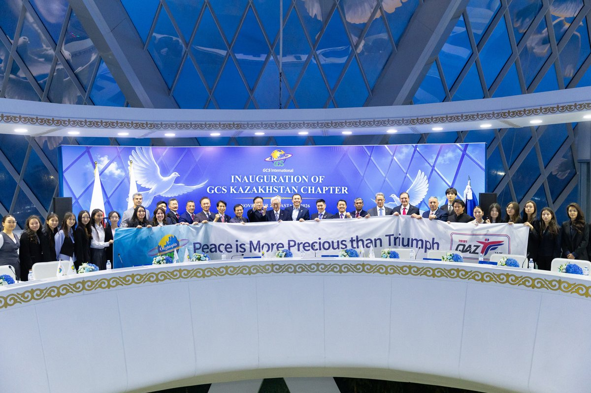
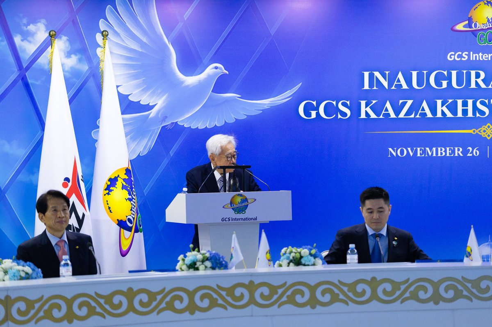
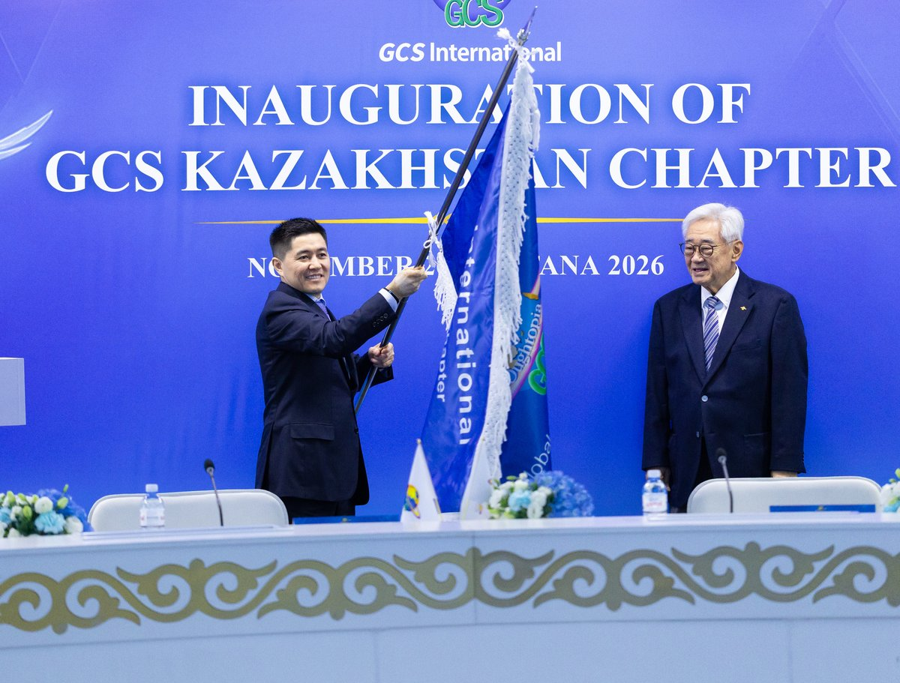

입력 2026-11-27

*26일 카자흐스탄 아스타나 '평화와 화해의 궁전'에서 열린 GCS 카자흐스탄 국가본부 창립식에서 참석자들이 "평화는 개선보다 귀하다" 현수막을 들고 기념촬영을 하고 있다. 사진=밝은사회클럽 국제본부 제공*

밝은사회클럽 국제본부(GCS International, 총재 조정원)가 카자흐스탄에 국가본부를 세웠다. 중앙아시아에서 평화·봉사 활동을 넓힐 거점이다.

밝은사회클럽 국제본부는 지난 26일(목) 카자흐스탄 수도 아스타나에서 'GCS 카자흐스탄 국가본부' 창립식을 열었다고 27일 보도자료에서 밝혔다. 초대 총재는 쿠르닷 샤미예프(Kurdat Shamiyev) 카자흐스탄태권도협회장이 맡았다.

## 아스타나 '평화와 화해의 궁전'서 창립식

창립식은 세계 종교 지도자 회의 등이 열리는 아스타나의 랜드마크 '평화와 화해의 궁전(Palace of Peace and Reconciliation)'에서 열렸다. '2026 월드태권도 그랑프리 파이널'(11월 27~29일) 개막을 하루 앞둔 날이었다.

이날 행사에는 조정원 GCS클럽 국제본부 총재(세계태권도연맹 총재), 쿠르닷 샤미예프 신임 GCS 카자흐스탄 총재, 게나디 골로브킨(Gennadiy Golovkin) 카자흐스탄 국가올림픽위원회(NOC) 위원장 등이 자리했다.

강석재 GCS클럽 국제본부 부총재, 김상진 GCS클럽 국제본부 이사(아시아태권도연맹 회장), 김인선 GCS 텍사스 총재, 마가블레 마헤르(Magableh Maher) GCS 호주 총재, 알렉세이 박(Alexey Park) GCS 키르기스스탄 총재(키르기스스탄태권도협회장), 양진방 WT 부총재(대한태권도협회장), 서정강 WT 사무총장, 제리 링 WT 비서실장, 라자 와심 아흐메드(Raja Wasim Ahmed) 파키스탄태권도협회 이사장 등 GCS와 WT 관계자 60여 명도 참석했다.

*GCS 카자흐스탄 국가본부 창립식 모습. 사진=밝은사회클럽 국제본부 제공*

## 타종·헌장 낭독…신임 총재에 깃발 수여

공식 행사는 조정원 총재의 GCS 종 타종으로 시작해 강석재 부총재의 GCS 헌장 낭독, 나데즈다 카미토바(Nadezhda Khamitova) GCS 카자흐스탄 부총재(카자흐스탄태권도협회 국제담당 부회장)의 집회 선서, GCS 명상 순으로 진행됐다. 참석자들은 제45차 UN 세계평화의 날 기념 영상과 GCS 국제본부 주요 활동, 태권도박애재단(THF) 창립 10주년 기념 영상을 함께 봤다.

취임식에서는 조정원 총재가 샤미예프 신임 총재에게 GCS 카자흐스탄 깃발과 임명패, 회원증을 수여했다. 샤미예프 총재는 취임 선서에서 현지 봉사와 평화 운동 확산에 앞장서겠다고 다짐했다.

*취임식에서 GCS 카자흐스탄 깃발을 흔들고 있다. 사진=밝은사회클럽 국제본부 제공*

## 2027년 WT 슬로건 'Together for Humanity'

조정원 총재는 축사에서 UN 세계평화의 날 제정 배경과 의의를 강조하며 "2026년 세계태권도연맹(WT) 슬로건인 'Reborn Together(함께 다시 태어나다)'에 이어, 2027년 슬로건을 'Together for Humanity(다 함께 인류를 위해)'로 정했다"며 "새해에는 전 세계 GCS 회원과 태권도 가족 모두가 인류 공영을 위한 봉사에 더욱 매진하자"고 말했다.

## 내년 7월 세계선수권 직전 'GCS 국제대회'도 아스타나서

조 총재는 다음 국제 행사 계획도 밝혔다. 조 총재는 "2027년 7월 7일 아스타나에서 개막하는 '2027 WT 세계태권도선수권대회' 개막 며칠 전에 '2027 GCS 국제대회'를 아스타나에서 개최하기로 신임 GCS 카자흐스탄 총재와 합의했다"고 말했다.

행사에 참석한 파키스탄, 이란 등 각국 태권도협회장들도 자국에 GCS 국가본부를 서둘러 만들고 싶다며 국제본부의 지원을 요청했다.

조 총재는 아랄 사티코브(Aral Sadykov)·나데즈다 카미토바 카자흐스탄태권도협회 부회장에게 GCS 감사장을 전달했다. 참석자들은 GCS 노래를 함께 부른 뒤 "평화는 개선보다 귀하다"라는 슬로건 현수막 앞에서 기념촬영을 했다. 행사는 조 총재의 폐회 타종으로 마무리됐고, 참석자들은 아스타나 리셉션홀(House of Receptions)에서 열린 환영 만찬에서 교류를 이어갔다.

※ 이 기사는 밝은사회클럽 국제본부 보도자료(11월 27일)를 바탕으로 작성했습니다. 사진은 밝은사회클럽 국제본부가 보도자료와 함께 제공한 것입니다.
