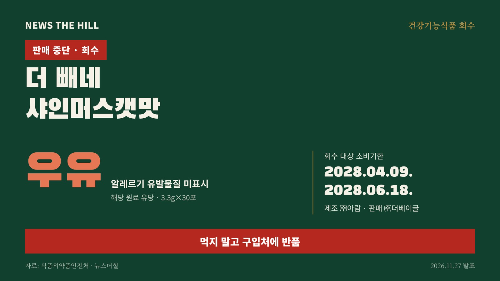

입력 2026-11-27

*그래픽=뉴스더힐(자료: 식품의약품안전처)*

알레르기 유발물질인 우유를 표시하지 않은 건강기능식품이 판매 중단·회수에 들어갔다. 소비기한이 2028년 4월 9일과 6월 18일로 표시된 '더 빼네 샤인머스캣맛' 제품이 대상이다. 우유 알레르기가 있는 소비자는 갖고 있는 제품을 확인해야 한다.

식품의약품안전처는 건강기능식품제조업체 주식회사 아람(경기도 광주시)이 제조하고 유통전문판매업체 주식회사 더베이글(경기도 의정부시)이 판매한 '더 빼네 샤인머스캣맛'(품목류: 가르시니아, 판토텐산, 비타민B1) 제품에 알레르기 유발물질(우유) 표시가 빠져 해당 제품을 판매 중단하고 회수 조치한다고 27일 보도참고자료에서 밝혔다.

## 회수 대상

- 제품명: 더 빼네 샤인머스캣맛
- 품목류: 가르시니아, 판토텐산, 비타민B1
- 제조업체: 주식회사 아람(건강기능식품 전문제조업, 경기도 광주시)
- 판매업체: 주식회사 더베이글(유통전문판매업, 경기도 의정부시)
- 소비기한: 2028년 4월 9일, 2028년 6월 18일로 표시된 제품
- 내용량: 3.3g×30포
- 생산량: 1,976kg
- 미표시 알레르기 유발물질: 우유(해당 원료 유당)
- 회수 기관: 경인지방식품의약품안전청

## 소비자 행동 요령

- 해당 제품을 샀다면 먹지 말고 산 곳에 반품한다. 식약처는 구매 소비자에게 섭취를 중단하고 구입처에 반품해 달라고 당부했다.
- 식품 관련 불법 행위를 보면 불량식품 신고전화 1399나 식품안전정보 앱 '내손안'으로 신고할 수 있다.

※ 이 기사는 식품의약품안전처 보도참고자료(정책브리핑 전재, 공공누리 제1유형·텍스트에 한함)를 바탕으로 작성했습니다.
