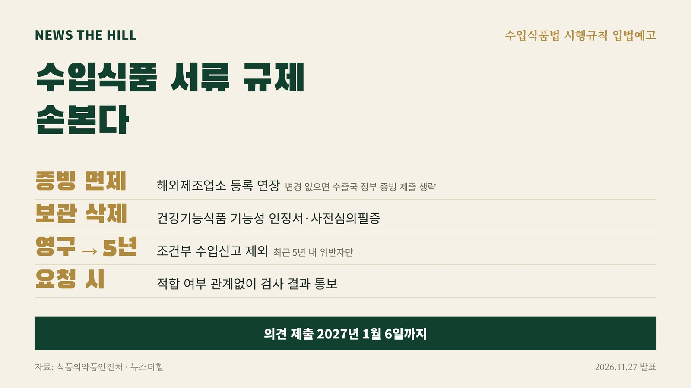

입력 2026-11-27

*그래픽=뉴스더힐(자료: 식품의약품안전처)*

해외제조업소 등록 유효기간을 연장할 때 기존 등록 정보에 바뀐 것이 없으면 수출국 정부가 발행한 증빙서류를 내지 않아도 된다. 건강기능식품 수입·판매업자가 기능성 인정서와 사전심의필증을 따로 보관해야 하는 의무도 없어진다.

식품의약품안전처는 이런 내용을 담은 「수입식품안전관리 특별법 시행규칙」 일부개정령안을 27일 입법예고했다고 이날 보도참고자료에서 밝혔다. 식약처는 업계의 현장 건의사항을 반영해 국민 건강과 직결되는 안전 규제는 유지하면서 영업자에게 불편을 주는 불합리한 행정규제를 개선하고, 「수입식품안전관리 특별법」 개정(2026년 9월 15일 공포, 2027년 3월 16일 시행)에 따른 하위법령을 정비하려는 것이라고 설명했다.

## 무엇이 바뀌나

- **해외제조업소 등록 연장 간소화**: 지금은 유효기간(2년)이 끝나기 전에 연장신청서와 정부 증빙서류를 반드시 내야 한다. 앞으로는 기존 등록 정보에 변경 사항이 없으면 수출국 정부 증빙서류를 내지 않는다. 현지실사나 해외식품 위생평가 등으로 연장 의사가 확인되면 별도 신청 없이 연장 신청을 한 것으로 인정한다.
- **건강기능식품 서류 보관 의무 삭제**: 건강기능식품 수입·판매업자에게 부과된 기능성 인정서와 기능성 표시·광고 사전심의필증 보관 의무를 없앤다. 기능성 인정서 등은 '식품안전나라' 누리집에서 확인할 수 있고, 기능성 표시·광고 사전심의도 자율심의로 바뀌었다는 이유다.
- **조건부 수입신고 제외 기준 합리화**: 지금은 조건부 수입신고 조건을 한 번만 어겨도 영구적으로 조건부 수입신고가 제한된다. 앞으로는 최근 5년 안에 조건을 위반한 영업자만 대상에서 뺀다. 식약처는 영업등록이 취소되면 재등록을 최대 5년간 제한하는 비슷한 규제와의 형평성을 고려했다고 밝혔다.
- **검사 결과 통보 확대**: 지금은 정부 수거·검사에서 부적합 판정을 받은 경우에만 결과를 알려준다. 앞으로는 영업자가 요청하면 적합 여부와 관계없이 문자메시지나 전자우편 등으로 검사 결과를 통보할 수 있게 한다.

조건부 수입신고는 정밀검사 결과를 확인하기 전이나 경미한 표시사항을 보완하기 전에 사용·판매를 금지하는 등의 조건을 붙여 수입신고를 수리하는 제도다.

## 의견 제출

개정안은 국민참여입법센터(opinion.lawmaking.go.kr)와 식약처 누리집(www.mfds.go.kr)의 '법령·자료→입법/행정예고'에서 볼 수 있다. 의견은 2027년 1월 6일까지 낼 수 있다.

※ 이 기사는 식품의약품안전처 보도참고자료(정책브리핑 전재, 공공누리 제1유형·텍스트에 한함)를 바탕으로 작성했습니다.
