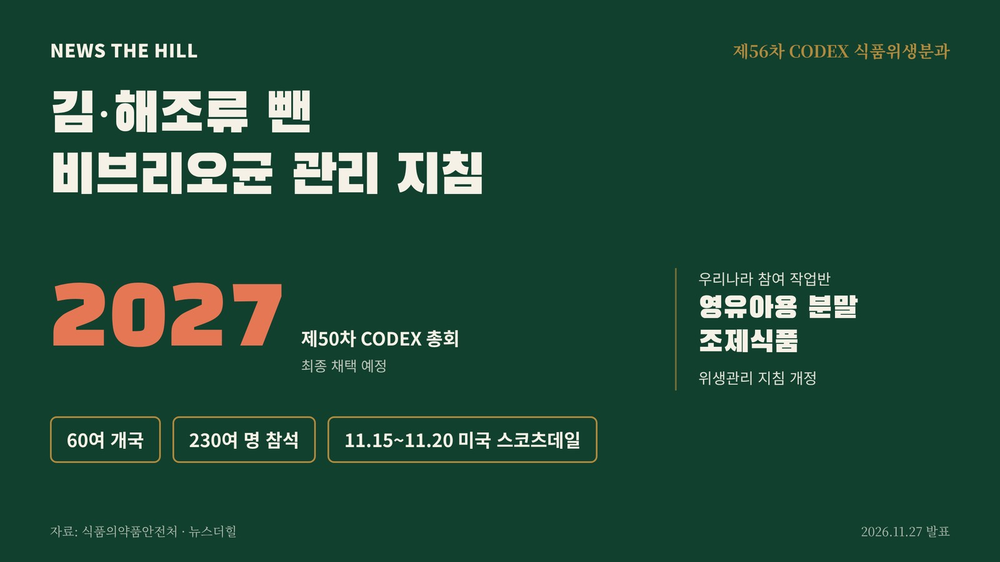

입력 2026-11-27

*그래픽=뉴스더힐(자료: 식품의약품안전처)*

김 같은 해조류가 수산물 비브리오균 관리 지침의 대상에서 빠진 채 국제 기준으로 채택될 전망이다. 우리 정부가 국제 회의에서 해조류를 제외하는 기존 '수산물(Seafood)' 정의를 유지하자고 제안한 결과다.

식품의약품안전처는 11월 15일부터 20일까지 미국 스코츠데일에서 열린 제56차 국제식품규격위원회(CODEX) 식품위생분과 회의에 참석해 수산물 중 비브리오균 관리 지침 등 국제 식품위생 기준에 우리나라 의견을 적극 제시했다고 27일 보도참고자료에서 밝혔다. CODEX는 1962년 유엔식량농업기구(FAO)와 세계보건기구(WHO)가 함께 세운 국제기구로, 식품별 기준과 규격을 정하고 관리한다.

## 회의에서 무엇을 논의했나

- 60여 개 회원국과 WHO·FAO 등 관계자 230여 명이 참석했다.
- 주요 의제는 식품 중 바이러스 관리 지침 개정, 수산물 중 병원성 비브리오균 관리 지침 개정, 신규 제안 작업의 우선순위 논의였다.

## 해조류는 왜 빼자고 했나

우리나라는 김 등 해조류를 먹어 비브리오균 식중독이 생기는 사례가 매우 드물다는 점을 들어, 해조류를 제외하는 기존 '수산물(Seafood)' 정의를 유지하고 이 용어를 일관되게 쓰자고 제안했다. 해조류까지 비브리오균 관리 대상에 들어가 불필요한 규제 부담이 생기지 않도록 하려는 것이라고 식약처는 설명했다. 해조류가 제외된 이 지침은 2027년 열릴 예정인 제50차 CODEX 총회에서 최종 채택될 예정이다.

우리나라는 제57차 회의에서 논의할 신규 작업의 우선순위도 검토했다. 여러 회원국이 지지한 '영유아용 분말 조제식품 위생관리 지침' 개정 작업반에도 참여하기로 했다.

식약처 관계자는 "이번 회의를 통해 우리나라의 식품위생 관리 경험과 입장을 국제 기준 논의에 반영하고, 국내 식품산업에 불필요한 규제 부담이 발생하지 않도록 적극 대응했다"며 "앞으로도 과학적 근거에 기반한 국제 식품위생 기준 마련에 적극 참여하겠다"고 밝혔다.

회의 자료는 CODEX 식품위생분과 누리집에서 볼 수 있고, 결과보고서는 식품안전나라(코덱스 분과별 결과보고서)에 올라올 예정이다.

※ 이 기사는 식품의약품안전처 보도참고자료(정책브리핑 전재, 공공누리 제1유형·텍스트에 한함)를 바탕으로 작성했습니다.
