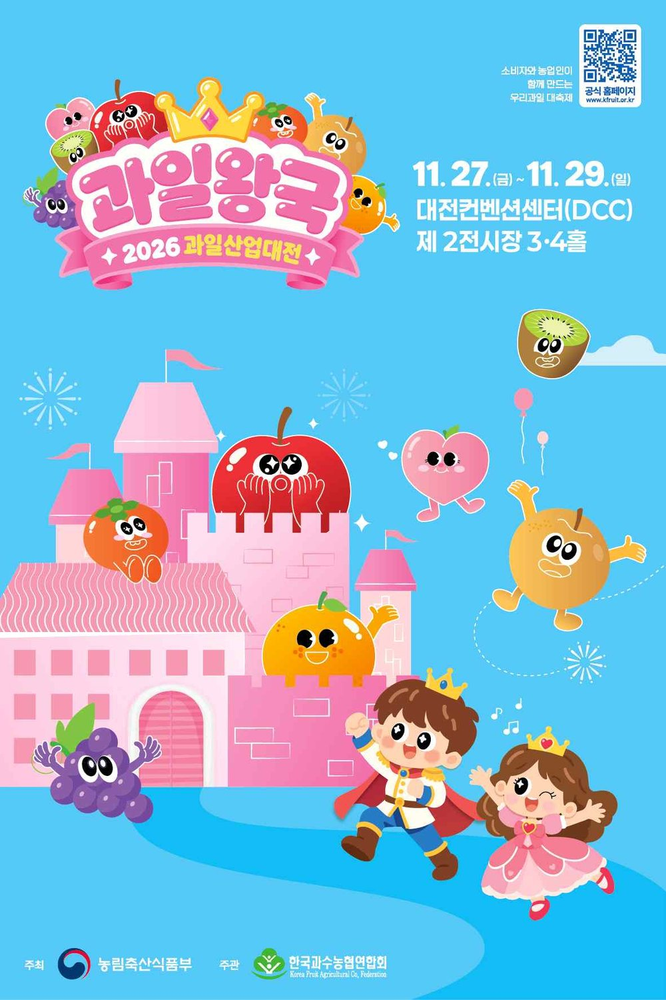

입력 2026-11-27

*2026 대한민국 과일산업대전 포스터. 자료=농림축산식품부 제공*

국산 과일을 한자리에서 보고 맛보고 살 수 있는 '2026 대한민국 과일산업대전'이 27일(금)부터 29일(일)까지 3일간 대전컨벤션센터(DCC) 제2전시장에서 열린다. 올해는 '과일왕국'을 내걸고 어린이를 데려온 가족이 즐길 수 있는 체험·전시 프로그램을 마련했다.

농림축산식품부는 27일 보도자료에서 이같이 밝혔다. 2011년 시작한 과일산업대전은 올해로 16회째다. 포스터에 따르면 행사장은 제2전시장 3·4홀이고, 한국과수농협연합회가 주관한다.

## 무엇을 하나

- **체험관**: 과일 연극, 마술쇼, 과일왕국 퍼레이드, 꼬마 농부 사과 수확 체험, AI 실감체험 등 어린이가 우리 과일을 재미있게 접할 수 있는 프로그램
- **주제 전시관**: 대표과일 선발대회 수상 과일, 국내에서 개발한 신품종, 과수산업 관련 정책 홍보
- **시식·장터**: 전국 과일 관련 단체의 국산 과일 시식행사와 이벤트, 고품질 과일을 저렴하게 파는 장터
- **수상자 과일 구매 코너**: 올해와 역대 대표과일 선발대회 수상자의 과일을 살 수 있다.

## 대표과일 선발대회

27일 개막식에서는 '2026 대표과일 선발대회' 수상자 시상과 지역 사회적 배려계층에 대한 과일 전달식이 열렸다. 선발대회는 과일의 외관, 당도, 산도, 경도 등을 심사해 11종류 과일의 분야별 대표 과일을 뽑았다. 대상(국무총리상)은 전북 이영주 씨의 포도(캠벨얼리)가 받았다.

서준한 농식품부 유통소비정책관은 "이상기상 등 어려운 여건에서도 과수 농가의 헌신적인 노력 덕분에 올해 사과 생산량이 증가했다"면서, "'대한민국 과일산업대전'이 과수 농업 종사자, 유통인, 소비자가 한 해의 결실을 확인하고 함께 즐기는 축제의 장이 되길 바란다"고 밝혔다.

과일 구매 등 문의는 한국과수농협연합회(054-534-8003)로 하면 된다.

※ 이 기사는 농림축산식품부 보도자료(정책브리핑, 공공누리 제1유형·출처표시)를 바탕으로 작성했습니다. 포스터는 농림축산식품부가 보도자료와 함께 제공한 것입니다.
